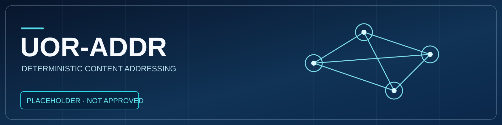

*Illustrative placeholder artwork, pending UOR Foundation brand review.*

# uor-addr

[](https://github.com/UOR-Foundation/uor-addr/actions/workflows/ci.yml)
[](https://crates.io/crates/uor-addr)
[](https://docs.rs/uor-addr)
[](LICENSE)

## Contents

- [What is this?](#what-is-this)
- [Quickstart](#quickstart)
- [Install (per ecosystem)](#install-per-ecosystem)
- [Which realization fits my data?](#which-realization-fits-my-data)
- [Distribution](#distribution)
- [Documentation](#documentation)
- [Project status](#project-status)
- [Contributing](#contributing)

> Typed content-addressing for data passing across system boundaries —
> deterministic, verifiable `blake3:<64hex>` labels with structural
> equivalence at the level of *what the data means*, not what its bytes
> happen to look like.

## What is this?

`uor-addr` turns a value into a stable identifier. Two values that mean
the same thing (whitespace differences, key reordering, Unicode
normalization, equivalent representations of the same number) get the
**same** identifier; two values that mean different things get
**different** identifiers, with the BLAKE3 sensitivity bound.

It does this by routing each format through a published canonical form
— JCS for JSON, Rivest's canonical S-expressions, XML-C14N 1.1, DER for
ASN.1 — then hashing the canonical bytes. Schema-pinned wrappers
(schema.org/Photograph, schema.org/Article, in-toto Statement v1) add
admission predicates without changing the label.

The library is **`no_std`-compatible**, but its default Cargo features
include **`std`**. Disable default features for an embedded/no-allocator
build; the ψ-pipeline itself is designed not to touch an allocator: a value's canonical form flows through it as a
source-polymorphic carrier (inline, borrowed, or streamed) with no input
size cap. The realizations whose canonical form needs no heap — ring,
sexp, asn1, codemodule — are fully `no_alloc` and build clean with
`--no-default-features`; the ones that materialize a canonical form
(json, xml, the `schema::*` descendants, gguf, onnx) gate `address()`
behind the `alloc` feature. The `std` feature is an ergonomic on-top
wrapper.

## Quickstart

### Add the library to a Rust application

You need Rust and Cargo. In an existing Cargo project, install the
published Rust package:

```sh
cargo add uor-addr
```

Use the library in `src/main.rs`:

```rust
use uor_addr::json::address;

fn main() {
    let outcome = address(br#"{"foo": "bar"}"#).expect("valid JSON input");
    println!("{}", outcome.address);
}
```

Run `cargo run`. The observable result is an address formatted as
`blake3:<64 hexadecimal characters>`. Its exact value depends on
the canonical input and chosen axis. The sample illustrates JSON addressing;
for further representation guarantees, run the dedicated conformance suite.
Crate installation and standalone consumer execution were **not rerun**
as part of this README-only change.

### Run the maintained source examples

```sh
git clone https://github.com/UOR-Foundation/uor-addr.git
cd uor-addr
cargo run -p uor-addr --example address_value
just examples
```

The first command runs the repository's checked-in
[`address_value` example](crates/uor-addr/examples/address_value.rs).
`just examples` runs the repository's example recipe, which includes
multiple format realizations. Commands are backed by source files; this
README edit itself does not constitute an independent execution test.

For constrained targets, consult [the feature manifest](crates/uor-addr/Cargo.toml)
and [verification guide](VERIFICATION.md). Defaults include `std`,
`gguf`, `onnx`, and `safetensors`; the `no_std` path requires
`--no-default-features`.

## Install (per ecosystem)

| Language | Install | Source |
|---|---|---|
| **Rust** | `cargo add uor-addr` | [crates.io/crates/uor-addr](https://crates.io/crates/uor-addr) |
| **JS / TS** (npm) | `npm install @uor-foundation/uor-addr` | [npmjs.com/package/@uor-foundation/uor-addr](https://www.npmjs.com/package/@uor-foundation/uor-addr) |
| **Python** | `pip install uor-addr` | [pypi.org/project/uor-addr](https://pypi.org/project/uor-addr/) |
| **C / embedded** | link `uor-addr-c` (`extern "C"` + `uor_addr.h`) | [crates.io/crates/uor-addr-c](https://crates.io/crates/uor-addr-c) |
| **Other (Go / .NET / Ruby / Java / Deno)** | consume the WASM Component Model via wasmtime | [crates.io/crates/uor-addr-wasm](https://crates.io/crates/uor-addr-wasm) |

Every binding produces the same 71-byte ASCII `blake3:<64hex>` κ-label byte-for-byte by default; `sha256:<64hex>` is one explicit axis selection away. See [RELEASING.md](RELEASING.md) for the polyglot release surface.

## Which realization fits my data?

| Format / standard | Module | Imported spec |
|---|---|---|
| JSON (RFC 8259 + RFC 8785 JCS) | `uor_addr::json` | [RFC 8785](https://datatracker.ietf.org/doc/rfc8785/) |
| S-expressions | `uor_addr::sexp` | [Rivest 1997](https://people.csail.mit.edu/rivest/Sexp.txt) |
| XML | `uor_addr::xml` | [W3C XML-C14N 1.1](https://www.w3.org/TR/xml-c14n11/) (subset) |
| ASN.1 | `uor_addr::asn1` | [ITU-T X.690 DER](https://www.itu.int/rec/T-REC-X.690) |
| Ring elements | `uor_addr::ring` | [UOR Amendment 43 §2](https://github.com/UOR-Foundation/UOR-Framework/wiki/Amendment-43) |
| Code-module AST | `uor_addr::codemodule` | CCMAS (UOR-native) |
| Photo metadata | `uor_addr::schema::photo` | [schema.org/Photograph](https://schema.org/Photograph) |
| Document / article | `uor_addr::schema::document` | [schema.org/Article](https://schema.org/Article) |
| Signed-software attestation | `uor_addr::schema::codemodule_signed` | [in-toto Statement v1](https://in-toto.io/Statement/v1) |
| Storage-tier cost model | `uor_addr::variant::storage` | ADR-048 + QS-06 |
| Signature cost model | `uor_addr::variant::signed` | ADR-048 + ADR-049 |

See [docs/realizations.md](docs/realizations.md) for guidance on
picking the right realization for your data.

## Distribution

| Crate | Target | Consumed by |
|---|---|---|
| [`uor-addr`](crates/uor-addr) | crates.io | Rust applications (host + embedded) |
| [`uor-addr-c`](crates/uor-addr-c) | C ABI (`extern "C"` + cbindgen header) | Embedded C/C++, Python `cffi`, Go `cgo`, Ruby `FFI`, .NET P/Invoke |
| [`uor-addr-wasm`](crates/uor-addr-wasm) | WASM Component Model (wit-bindgen) | JS/TS (via `jco`), Python (`wasmtime-py`), Go (`wasmtime-go`), .NET, Ruby, Java |

All three paths produce the **same 71-byte κ-label byte-for-byte** for
the same input. The ψ-pipeline is allocator-free; only the FFI
marshalling layers allocate when their target ABI requires it (e.g.
WIT Component Model `list<u8>` → `Vec<u8>`).

## Documentation

| Read | If you want to |
|---|---|
| [docs/getting-started.md](docs/getting-started.md) | Mint your first κ-label end-to-end |
| [docs/realizations.md](docs/realizations.md) | Pick the right realization for your data |
| [ARCHITECTURE.md](ARCHITECTURE.md) | Understand how UOR-ADDR fits the UOR-Framework |
| [STANDARDS.md](STANDARDS.md) | Cite the imported specs |
| [CONFORMANCE.md](CONFORMANCE.md) | Reference an invariant ID in a PR or test |
| [VERIFICATION.md](VERIFICATION.md) | Reproduce the V&V acceptance gate (`just vv`) |
| [ANALYSIS.md](ANALYSIS.md) | Read the empirical-analysis derivation |

## Project status

- 361 tests pass across 22 test binaries; every realization has a
  published-spec conformance suite, plus 19,074 vectors × 5 identities
  from UCD 15.1.0 `NormalizationTest.txt` exercising the in-crate NFC
  normalizer.
- 20 runnable examples (`just examples`), including content-addressed
  GGUF/ONNX model registry + provenance and κ-label composition.
- `#![forbid(unsafe_code)]` for the core crate; `no_std` by default,
  with the ring/sexp/asn1/codemodule realizations `no_alloc` (verified
  by `cargo build --no-default-features --target thumbv7em-none-eabihf`).
- C ABI bindings + WASM Component Model bindings ship under
  [`crates/uor-addr-c`](crates/uor-addr-c) and
  [`crates/uor-addr-wasm`](crates/uor-addr-wasm).
- Apache-2.0 licensed.

## Contributing

The conformance contract in [CONFORMANCE.md](CONFORMANCE.md) is the
normative surface. Any PR that changes observable behavior must
either update the contract (declaring an explicit change) or fix the
code. The `just vv` gate must pass.
